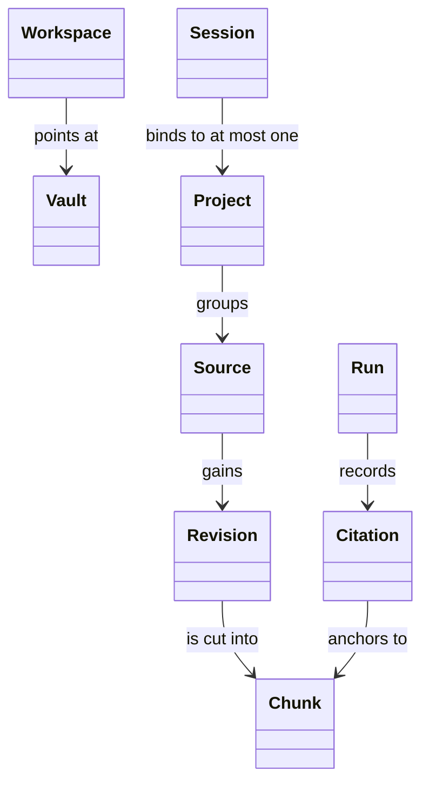
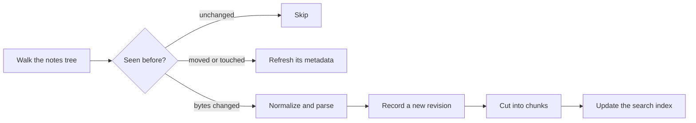

# The domain model {/* #domain-model */}

Every page on this site uses the same handful of nouns, and each one means
exactly one thing. This page draws the map; the [glossary](../glossary.md)
defines each entry in one sentence.

## The shape of the model {/* #map */}

The map in one picture — each arrow is a relationship the glossary defines:

A workspace points at exactly one vault; a source accumulates immutable
revisions; a revision is cut into chunks; projects group sources; sessions
bind to at most one project; and citations anchor answers to the chunks
they rest on.

## The ground: a workspace over a vault {/* #ground */}

You work inside a [workspace](../glossary.md#workspace) — one directory with
one database — and point it at a [vault](../glossary.md#vault): the single
tree of Markdown notes you already keep. Indexing covers that tree and
nothing else; the database and the paper bytes live beside it.

## From notes to library material {/* #indexing */}

Indexing is the path from files to citable material — and it only ever
appends:

Unchanged files are skipped; one that only moved or was touched gets its
recorded metadata refreshed; one whose bytes changed becomes a new
revision, then chunks, then index entries. The first pass over a new note
is just the same path with nothing recorded before. Nothing in the store is
overwritten — updates append.

## Sources are identities, not paths {/* #sources */}

Whatever the library can cite is a [source](../glossary.md#source): a note, a
paper, later a web document. A source is identified by its
[source key](../glossary.md#source-key) (`note:…`, `arxiv:…`), not by where
it happens to live on disk — renaming a file makes a new source, and old keys
are never rewritten. Each time a source changes it gains a new
[source revision](../glossary.md#source-revision): an immutable snapshot of
the bytes. Updates append; nothing overwrites.

## Retrieval works on chunks {/* #chunks */}

A revision is cut into [chunks](../glossary.md#chunk) — deterministic
projections that retrieval finds and citations point at. Every chunk carries
an [origin class](../glossary.md#origin-class): who wrote the bytes — your
notes, papers, web pages, agent output, or the system itself. One index
covers notes and papers together, and a query returns the mixed result
ranked with origin weights, so the two kinds of material check each other —
the full picture is on [retrieval and citations](retrieval-and-citations.md).

## The desk: projects, sessions, annotations, sparks {/* #desk */}

On top of the library sits your desk. A [project](../glossary.md#project) is
a named collection of sources — a drawer, not a second library. A
[session](../glossary.md#session) is a conversation thread bound to at most
one project. An [annotation](../glossary.md#annotation) pins a human note to
an exact spot in a revision. A [spark](../glossary.md#spark) is a
citation-backed card the agent proposes; pinning or dismissing is the only
way it moves.

## Work and answers: runs {/* #runs */}

Every accepted piece of work is a [run](../glossary.md#run) — recorded,
auditable, with a terminal status. An [ask](../glossary.md#ask) is the run
that retrieves, builds context in code, and then makes at most one model
turn; what enters that context is governed by
[context scope](../glossary.md#context-scope). Answers carry
[citations](../glossary.md#citation) — the five-tuple binding a claim to
bytes — and every citation undergoes
[verification](../glossary.md#verification) against the recorded revision.
The whole reconstruction is a [trace](../glossary.md#trace) you can replay.

## Where to go next {/* #next */}

- [What Momotaro is](positioning.md) — the posture behind the model.
- [Retrieval and citations](retrieval-and-citations.md) — how the pieces work
  together on a single query.
- [Design decisions](decisions.md) — why each shape was chosen.
- [The glossary](../glossary.md) — one line per term.
