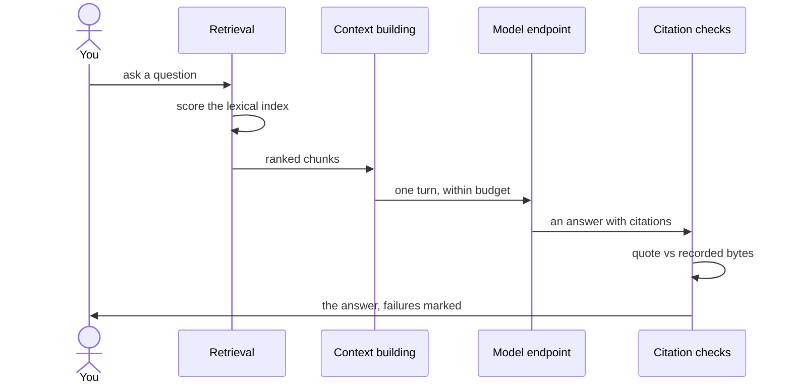

# Retrieval and citations {/* #retrieval-and-citations */}

This is the loop at the center of the workbench: a query meets one lexical
index, the best material comes back ranked, and every claim in an answer
points back at bytes that can be checked.

## One ask, end to end {/* #one-ask */}

The loop as one sequence:

Code does everything up to that single model turn, and code checks
everything after it — the model never decides what to retrieve, and never
certifies its own answer.

## One index over notes and papers {/* #one-index */}

Notes and papers live in a single lexical index, so one query returns them
mixed — a paper hit can sit right next to the note about it, and a note hit
can bring its paper along. Results are ranked with origin weights: your own
writing counts more than papers, papers more than web copies. Same-library
retrieval is the point of the design — the two kinds of material check each
other — rather than two searches stitched together.

## Deterministic first {/* #deterministic */}

Searching costs no model involvement: scoring is lexical, and CJK text is
tokenized natively. That is what makes search fast, offline and explainable —
and it is why a search runs the same way on every machine, every time.

## From hits to chunks {/* #hits-to-chunks */}

Retrieval works on [chunks](../glossary.md#chunk). Each hit is a chunk of a
specific [source revision](../glossary.md#source-revision), which is what
makes a [citation](../glossary.md#citation) possible at all. A hit is not an
answer; it is evidence with a location.

## The citation five-tuple {/* #citation-tuple */}

Every claim in an answer can be traced through the five-tuple: the source
key, the revision, the locator inside it, the quoted text, and a hash of that
text. Together they pin the claim to bytes — not to a document "in general",
but to the exact text that existed when the run happened.

## Verification is a first-class state {/* #verification */}

Before an answer is shown, each of its citations is checked against the
recorded revision: the quote must actually be there, byte for byte. A
citation that fails is reported as failed — prominently, never quietly
dropped — because a model's recollection is not evidence; the recorded bytes
are. Verification failure is a designed outcome, not an error condition.

## What reaches the model {/* #context */}

Retrieval decides what is worth showing; [context
scope](../glossary.md#context-scope) decides what may enter the model's
context: P1 is the bound project's material (or the whole vault when nothing
is bound), P2 is everything else. The split affects only what the model sees
— never what retrieval recorded.

## Replay {/* #replay */}

The query, the evidence, the prompt, the model's answer and the verification
verdicts are recorded together as a [trace](../glossary.md#trace). A [run](../glossary.md#run)
you cannot replay is a run you cannot trust.

## Where to go next {/* #next */}

- [The domain model](domain-model.md) — the nouns used above.
- [Design decisions](decisions.md) — why lexical-first, why verification is
  a state and not a side note.
