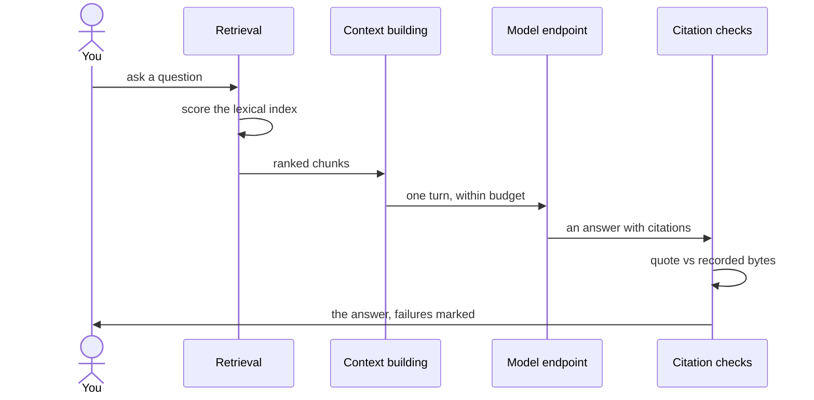

# Retrieval and citations

This is the loop at the center of the workbench: a query meets one lexical
index, the best material comes back ranked, and every claim in an answer
points back at bytes that can be checked.

## One ask, end to end

The loop as one sequence:

Code does everything up to that single model turn, and code checks
everything after it — the model never decides what to retrieve, and never
certifies its own answer.

## One index over notes and papers

Notes and papers live in a single lexical index, so one query returns them
mixed — a paper hit can sit right next to the note about it, and a note hit
can bring its paper along. Results are ranked with origin weights: your own
writing counts more than papers, papers more than web copies. Same-library
retrieval is the point of the design — the two kinds of material check each
other — rather than two searches stitched together.

## Deterministic first

Searching costs no model involvement: scoring is lexical, and CJK text is
tokenized natively. That is what makes search fast, offline and explainable —
and it is why a search runs the same way on every machine, every time.

## From hits to chunks

Retrieval works on [chunks](../glossary.md#chunk). Each hit is a chunk of a
specific [source revision](../glossary.md#source-revision), which is what
makes a [citation](../glossary.md#citation) possible at all. A hit is not an
answer; it is evidence with a location.

## The citation five-tuple

Every claim in an answer can be traced through the five-tuple: the source
key, the revision, the locator inside it, the quoted text, and a hash of that
text. Together they pin the claim to bytes — not to a document "in general",
but to the exact text that existed when the run happened.

## What an answer is made of

An answer is a sequence of **quoted spans**, not free prose. The model
selects the spans that answer the question and writes nothing else; the
wording that joins them is a fixed connector that claims nothing — no
sentence boundary, no relationship between the spans. Those are things a
source would have to say, and a source says them inside its own text.

That is what makes a claim checkable. Every factual byte in an answer comes
from a span, and every span can be looked up in the recorded revision. A
sentence the model wrote that is not a span has nowhere to go.

## Verification is a first-class state

Before an answer is shown, each of its spans is checked against the recorded
revision: the quote must actually be there, byte for byte. A span that fails
is reported as failed — prominently, never quietly dropped — because a
model's recollection is not evidence; the recorded bytes are. Verification
failure is a designed outcome, not an error condition.

Three things can come back, and the difference matters:

| | What it means | What you see |
|---|---|---|
| **Located** | The quote is in the recorded bytes, exactly. | Shown normally. |
| **Not located** | It could not be checked, or the bytes do not match. | Marked and shown apart from the rest — never dressed up as a conclusion. |
| **Sources disagree** | Two sources carry the same span differently. | Both are shown, with where each came from. |

A span without a check is not rendered at all: there is no half-checked
answer.

**What "located" does and does not claim.** It means the quote points at
real bytes in the recorded revision. It does **not** mean the words support
the sentence they were joined into — no machine reads for that. The wording
on screen says *quoted from*, not *verified*: the claim is exactly as strong
as the check that was actually run.

## What reaches the model

Retrieval decides what is worth showing; [context
scope](../glossary.md#context-scope) decides what may enter the model's
context: P1 is the bound project's material (or the whole vault when nothing
is bound), P2 is everything else. The split affects only what the model sees
— never what retrieval recorded.

## Replay

The query, the evidence, the prompt, the model's answer and the verification
verdicts are recorded together as a [trace](../glossary.md#trace). A [run](../glossary.md#run)
you cannot replay is a run you cannot trust.

## Where to go next

- [The domain model](domain-model.md) — the nouns used above.
- [Design decisions](decisions.md) — why lexical-first, why verification is
  a state and not a side note.
