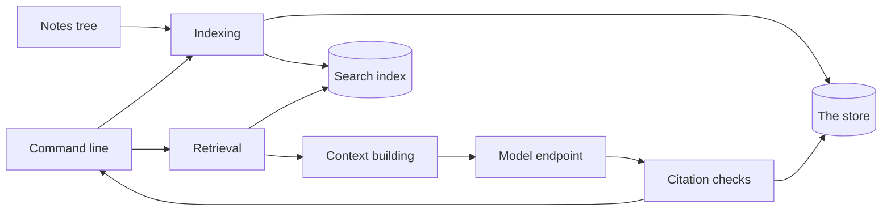
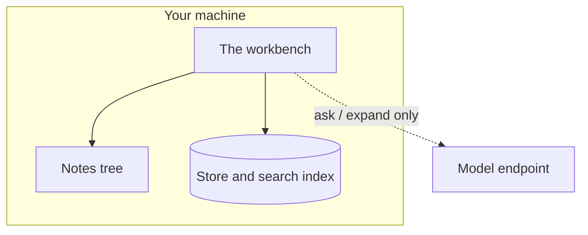

# System overview {/* #system-overview */}

This page is the map: the few parts the workbench is made of, where they
run, and which part to look at when something needs to change.

## The parts and the path of a piece of work {/* #parts */}

Work enters through **indexing**: notes are walked, normalized and recorded
in the store as immutable revisions, then projected into the search index.
A question travels the other way: **retrieval** reads the index, **context
building** assembles what may enter a single model turn, and **citation
checks** hold the answer against the recorded bytes before you see it.

## The parts, one line each {/* #list */}

- **Indexing** picks up what changed in your notes, normalizes it, and
  records the result — revisions, chunks, and the audit events around them.
- **The store** is the database that holds the workbench's facts:
  revisions, runs, citations, the desk itself.
- **The search index** is the derived, rebuildable index that matches
  queries to chunks; losing it costs time, never data.
- **Retrieval** scores a query against the index and returns ranked,
  located evidence.
- **Context building** decides what may enter the model's context, within a
  fixed budget.
- **Model transport** talks to the one provider endpoint you configure —
  the only network path, used by `ask` and expanded search and nothing
  else.
- **Citation checks** compare each claim's quote against the recorded
  bytes; failures stay visible.
- **The command line** is the surface today: it takes your commands and
  shows results. Later surfaces call the same parts.

## Where everything runs {/* #where */}

Everything except one dashed arrow runs on your machine. Indexing, search,
trace and citation checks need no network at all; the only outbound
connection is the model endpoint you configure. A workspace is a directory:
copying it copies the desk — and nothing about your library is collected or
sent anywhere.

## Which part changes when {/* #changes */}

| When the change is about… | The part to look at |
|---|---|
| how notes are picked up, normalized, or cut into chunks | Indexing |
| what counts as recorded fact — revisions, runs, citations, the desk | The store |
| how queries are scored, weighted, or tokenized | The search index and retrieval |
| what may enter the model's context, and its budget | Context building |
| the conversation with the provider | Model transport |
| what "verified" means for a citation | Citation checks |
| what the surface shows and prints | The command line |

This map deliberately stops at component names: components are what stays
stable while their internals change.

## Where to go next {/* #next */}

- [The domain model](domain-model.md) — the nouns, each defined in one
  line.
- [Retrieval and citations](retrieval-and-citations.md) — the central loop,
  step by step.
- [Design decisions](decisions.md) — why the shape is what it is.
