# Inspect a run {/* #trace-a-run */}

Every [run](../glossary.md#run) is recorded so it can be answered after the
fact. The `ask` answer prints the id; hand it to `trace`:

```bash
momotaro trace <run_id>
```

The replay answers four questions in order:

1. **What did retrieval find?** The query as it ran, and the ranked hits with
   their locations.
2. **What did the model see?** The exact context fragments that were sent —
   nothing more was in front of it.
3. **Which citations were used?** The five-tuple of each claim: source key,
   revision, locator, quote, hash.
4. **Did they verify?** The verdict of each citation check against the
   recorded bytes.

Add `--json` when a script should read any of it.

## The life of a run {/* #life */}

Every run follows the same path, and its ending is recorded with it:

```mermaid
stateDiagram-v2
    accTitle: The life of a run
    accDescr: A run is accepted, begins, and ends in exactly one terminal state recorded with it — finished or failed. A trace replays the run from that record; nothing is reconstructed from memory.
    [*] --> accepted
    accepted --> running
    running --> finished
    running --> failed
    finished --> [*]
    failed --> [*]
```



The state names are the recorded values themselves — they keep their
spelling in every language, and `trace` replays them as written.

## Why this matters {/* #why */}

A run you cannot replay is a run you cannot trust — that is the whole point of
recording runs at all. When an answer feels wrong, the trace turns "the model
said something odd" into a concrete question: did retrieval miss, did the
context lack the right fragment, or did a claim fail its check. Each of those
has a different fix.

The same command works for the runs behind `search --mode expand`, which
records its one query-rewriting turn the same way.

## Where to go next {/* #next */}

- [The citation loop](../concepts/retrieval-and-citations.md) — what the four
  answers mean together.
- [Ask with citations](ask-with-citations.md) — where run ids come from.
