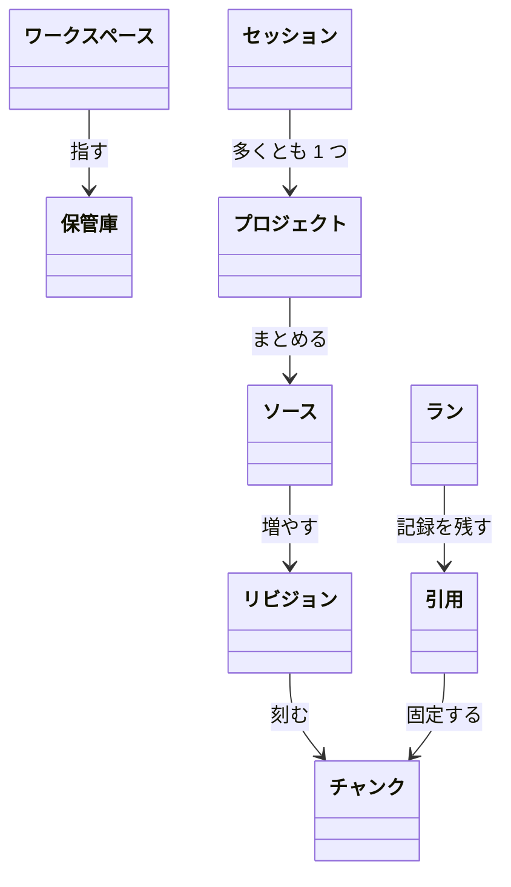
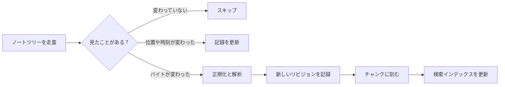

# ドメインモデル {/* #domain-model */}

このサイトのすべてのページは、同じひと握りの名詞だけを使います。そしてどの名詞も意味はただ 1 つです。このページは地図を描きます。各項目の一文定義は[用語集](../glossary.md)にあります。

## モデルの形 {/* #map */}

1 枚の絵にした地図——どの矢印も用語集が定義した関係です：

ワークスペースはちょうど 1 つの保管庫を指します。ソースは不変のリビジョンを増やし、リビジョンはチャンクに刻まれます。プロジェクトはソースをまとめ、セッションは多くとも 1 つのプロジェクトに結び付きます。引用が、答えをそれが乗っているチャンクに固定します。

## 土台：保管庫の上にワークスペース {/* #ground */}

作業は[ワークスペース](../glossary.md#workspace)——1 つのディレクトリと 1 つのデータベース——の中で行い、それを[保管庫](../glossary.md#vault)に向けます。保管庫とは、あなたがすでに使っている唯一の Markdown ノートツリーです。索引が覆うのはそのツリーだけ。データベースと論文の原本はそのそばに置かれます。

## ノートからライブラリの材料へ {/* #indexing */}

取り込みはファイルを引用できる材料に変える通路です——しかも追加しか行いません：

変わっていないファイルはスキップされます。移動しただけ、触られただけのファイルは、記録された位置が更新されます。バイトが変わったファイルは、新しいリビジョンになり、次にチャンク、次に索引の項目になります。新しいノートの最初の 1 回も同じ道で、手前に何も記録されていないだけです。ストアの中の何も上書きされません——更新は追加です。

## ソースは同一性であり、パスではない {/* #sources */}

ライブラリが引用できるものはすべて[ソース](../glossary.md#source)です。ノート、論文、将来はウェブ文書も。[ソース](../glossary.md#source)の同一性は[ソースキー](../glossary.md#source-key)（`note:…`、`arxiv:…`）が決めます。ディスク上の居場所ではありません——ファイル名を変えれば新しいソースになり、古いキーが書き換わることはありません。ソースが変わるたびに新しい[ソースリビジョン](../glossary.md#source-revision)が増えます。不変のバイトスナップショットです。更新は追加であり、何も上書きしません。

## 検索はチャンク単位 {/* #chunks */}

リビジョンは[チャンク](../glossary.md#chunk)に刻まれます。検索が当て、引用が指す、決定的な射影です。どのチャンクも[オリジンクラス](../glossary.md#origin-class)を持ちます——バイトを書いたのは誰か：あなたのノート、論文、ウェブ、エージェントの産物、システム自身。1 つの索引がノートと論文を一緒に覆い、クエリはオリジン加重付きの混ざった結果を返します。2 種類の材料が互いを照合する仕組みの全体は[検索と引用](retrieval-and-citations.md)にあります。

## 机：プロジェクト、セッション、注釈、スパーク {/* #desk */}

ライブラリの上にあなたの机があります。[プロジェクト](../glossary.md#project)はソースの集まりに付けた名前——引き出しであって、2 つ目のライブラリではありません。[セッション](../glossary.md#session)は、多くとも 1 つのプロジェクトに結び付く会話のひもです。[注釈](../glossary.md#annotation)は人手のメモをリビジョンの正確な位置に留めます。[スパーク](../glossary.md#spark)はエージェントが提案する引用付きカード。ピン留めか却下だけが、その行き先です。

## 労働と答え：ラン {/* #runs */}

受理された労働の 1 単位はすべて[ラン](../glossary.md#run)です——記録され、監査でき、終端状態を持ちます。[アスク](../glossary.md#ask)は、コード側で検索とコンテキスト構築を行い、そのあとモデル呼び出しを多くとも 1 回行うランです。コンテキストに入る内容は[コンテキスト範囲](../glossary.md#context-scope)が決めます。答えは[引用](../glossary.md#citation)——主張をバイトに固定する五つ組——を伴い、すべての引用は記録されたリビジョンに対して[検証](../glossary.md#verification)されます。その再構成の全体が、再生できる[トレース](../glossary.md#trace)です。

## 次に読むもの {/* #next */}

- [モモタロウとは](positioning.md)——モデルの背後の姿勢。
- [検索と引用](retrieval-and-citations.md)——1 回のクエリで部品たちがどう噛み合うか。
- [設計判断](decisions.md)——それぞれの形が選ばれた理由。
- [用語集](../glossary.md)——1 語につき一行。
