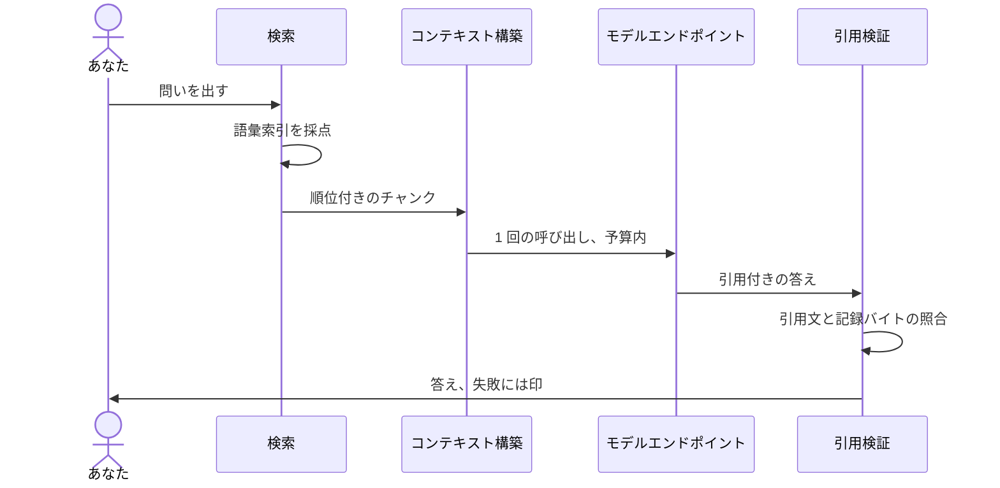

# 検索と引用

これがワークベンチの中心にあるループです。クエリが 1 つの語彙索引に当たり、最良の材料が順位付きで返り、答えの中のすべての主張が、確認できるバイトを指し返します。

## アスク 1 回、端から端まで

中心のループを 1 本のシーケンスにすると：

あの 1 回のモデル呼び出しの手前まではすべてコードが行い、そのあとの検査もすべてコードが行います——モデルは何を取り出すかを決めず、自分の答えを認定もしません。

## ノートと論文を 1 つの索引で

ノートと論文は同じ語彙索引に住むので、1 回のクエリが両方を混ぜて返します——論文のヒットのすぐ隣にそれを語るノートが並び、ノートのヒットがその論文を連れてきます。結果はオリジン加重で順位付けされます。あなた自身の書き物は論文より、論文はウェブの写しより重く数えます。同一ライブラリ検索はこの設計の眼目です——2 種類の材料が互いを照合する——2 つの検索を縫い合わせるのではありません。

## 決定論を先に

検索はモデルの力を一切使いません。スコアリングは語彙ベースで、日中韓のテキストはネイティブにトークン化されます。だから検索は速く、オフラインで、説明可能です——そしてどのマシンでも、いつでも同じように動きます。

## ヒットからチャンクへ

検索の単位は[チャンク](../glossary.md#chunk)です。ヒットとは特定の[ソースリビジョン](../glossary.md#source-revision)の 1 チャンク——だからこそ[引用](../glossary.md#citation)が成立します。ヒットは答えではありません。位置を持つ証拠です。

## 引用の五つ組

答えの中のすべての主張は五つ組でたどれます。ソースキー、リビジョン、その中のロケータ、引用文、そして引用文のハッシュ。これらが主張をバイトに固定します——「だいたい存在する」文書ではなく、そのランが起きた時に実在した正確なテキストに。

## 答いは何でできているか

答えは**引用されたスパンの列**であり、自由な散文ではありません。モデルは問いに答えるスパンを選び、それ以外は何も書きません。それらをつなぐ言葉は固定の接続語集合から取り、何も主張しません——文の境界も、スパン同士の関係も。それらはソース自身が言うべきことで、ソースは自分の本文の中でそれを言います。

これが主張を検証可能にする理由です。答えの中のすべての事実バイトはスパン由来であり、どのスパンも記録されたリビジョンの中で探せます。モデルが書いたのにスパンに該当しない一文には、行く場所がありません。

## 検証は第一級の状態

答えが示される前に、そのすべてのスパンが記録されたリビジョンと照合されます。引用文は一字一句そこに実在しなければなりません。失敗したスパンは失敗として——目立つように、決して静かに捨てずに——報告されます。モデルの記憶は証拠ではありません。記録されたバイトが証拠です。検証の失敗は設計された結末であり、エラー状態ではありません。

戻ってくる結果は 3 つで、その違いは重要です。

| | 意味 | 見えるもの |
|---|---|---|
| **位置確定** | 引用文が記録バイトに一字一句そのまま在る。 | 通常どおり表示。 |
| **位置未確定** | 照合できない、またはバイトが一致しない。 | 印を付けて他と分けて表示——結論のように見せることはしません。 |
| **ソース間の不一致** | 同じスパンについて 2 つのソースが異なると言う。 | 両方を、それぞれの出所付きで示す。 |

**照合されていないスパンはそもそも描画されません。**「半分照合済み」の答えは存在しません。

**「位置確定」が主張するもの・しないもの。** 言っているのは、この引用が記録リビジョンの実在バイトを指すということ。その語句が、つなぎ合わされた一文を裏付けているとは**言っていません**——それを読み取る機械は存在しません。画面の文言は**〜から引用**であって**検証済み**ではありません。主張の強さは、実際に実行された照合の強さに等しくしかありません。

## モデルに届くもの

検索は「見せる価値のあるもの」を決め、[コンテキスト範囲](../glossary.md#context-scope)は「モデルのコンテキストに入ってよいもの」を決めます。P1 は結び付いたプロジェクトの材料（未結び付けなら保管庫全体）、P2 はそれ以外。この区分はモデルが見るものだけに効き——検索が記録したものには決して影響しません。

## 再生

クエリ、証拠、プロンプト、モデルの答え、検証の判定は、まとめて[トレース](../glossary.md#trace)として記録されます。再生できない[ラン](../glossary.md#run)は、信頼できないランです。

## 次に読むもの

- [ドメインモデル](domain-model.md)——上で使った名詞たち。
- [設計判断](decisions.md)——なぜ語彙優先なのか、なぜ検証が脚注ではなく状態なのか。
