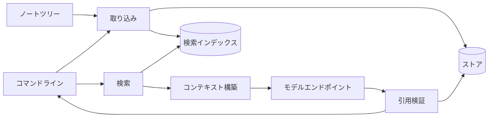
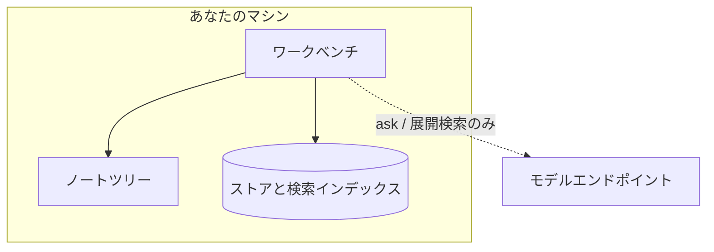

# システム概要 {/* #system-overview */}

このページは地図です。ワークベンチを成すわずかな部品、それらがどこで動くか、そして何かを変えるとき、どこを見ればよいか。

## 部品と、仕事の通り道 {/* #parts */}

仕事は**取り込み**から入ります。ノートが走査され、正規化され、不変のリビジョンとしてストアに記録され、検索インデックスへ射影されます。問いは逆向きに進みます：**検索**がインデックスを読み、**コンテキスト構築**が 1 回のモデル呼び出しに入ってよいものをまとめ、**引用検証**があなたが見る前に答えを記録されたバイトと照合します。

## 部品、それぞれ一行で {/* #list */}

- **取り込み**はノートの変化を拾い、正規化し、結果——リビジョン、チャンク、それらを囲む監査イベント——を記録します。
- **ストア**はワークベンチの事実を収めるデータベースです：リビジョン、ラン、引用、机そのもの。
- **検索インデックス**は再構築できる派生索引で、クエリとチャンクを突き合わせます。失っても時間の損だけで、データは失いません。
- **検索**はクエリをインデックスに対して採点し、位置付きの証拠を順位付きで返します。
- **コンテキスト構築**は、固定の予算の中で、モデルのコンテキストに入ってよいものを決めます。
- **モデル呼び出し**は、あなたが設定した 1 つのプロバイダー端点とだけ話します——唯一のネットワーク経路で、`ask` と展開検索だけが使い、それ以外は使いません。
- **引用検証**は各主張の引用文を記録されたバイトと照合します。失敗は可視のまま残ります。
- **コマンドライン**が今日の面です：コマンドを受け取り、結果を見せます。将来の面も同じ部品を呼びます。

## どこで動くか {/* #where */}

破線 1 本を除いて、すべてがあなたのマシンの上で動きます。索引、検索、再生、引用検証はネットワークを一切必要としません。外向きの接続は、あなたが設定したモデルエンドポイントだけです。ワークスペースは 1 つのディレクトリです——コピーすれば机ごとコピーになり、ライブラリがどこかに収集・送信されることはありません。

## 変更はどこを見るか {/* #changes */}

| 変えたいのが…… | 見る部品 |
|---|---|
| ノートをどう拾い、正規化し、チャンクに切るか | 取り込み |
| 何が記録された事実か——リビジョン、ラン、引用、机 | ストア |
| クエリをどう採点・加重・トークン化するか | 検索インデックスと検索 |
| 何がモデルのコンテキストに入れるか、予算はいくらか | コンテキスト構築 |
| プロバイダーとの会話 | モデル呼び出し |
| 引用が「検証済み」であるとはどういうことか | 引用検証 |
| 面が何を見せ、何を印字するか | コマンドライン |

この地図は意図的に部品名で止まります。内部は変わりますが、部品は変わりません。

## 次に読むもの {/* #next */}

- [ドメインモデル](domain-model.md)——名詞を 1 行ずつ。
- [検索と引用](retrieval-and-citations.md)——中心のループを順に。
- [設計判断](decisions.md)——なぜこの形なのか。
