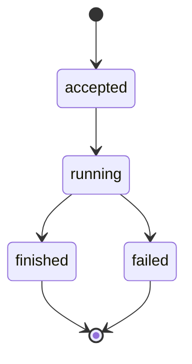

# 実行を調べる {/* #trace-a-run */}

すべての[ラン](../glossary.md#run)は記録され、後から答えられます。`ask` の答えが id を印字するので、`trace` に渡します：

```bash
momotaro trace <run_id>
```

再生は 4 つの問いに順番に答えます：

1. **検索は何を見つけたか？** 実行時のクエリと、位置付きの順位付きヒット。
2. **モデルは何を見たか？** 実際に送られたコンテキスト断片——それ以外は目の前にありませんでした。
3. **どの引用が使われたか？** 各主張の五つ組：ソースキー、リビジョン、ロケータ、引用文、ハッシュ。
4. **検証を通ったか？** 各引用と記録されたバイトの照合の判定。

スクリプトがどれかを読むときは `--json` を。

## ランのライフサイクル {/* #life */}

どのランも同じ道をたどり、終わりはランと一緒に記録されます：



状態名は記録された値そのものです——どの言語でも綴りは変わらず、`trace` は書かれたままを再生します。

## なぜ重要か {/* #why */}

再生できないランは、信頼できないランです——ランの記録そのものの意味がここにあります。答えがおかしいと感じたとき、トレースは「モデルが妙なことを言った」を具体的な問いに変えます：検索が取り逃したのか、コンテキストに適切な断片が欠けていたのか、ある主張が検査に落ちたのか。それぞれ直し方が違います。

同じコマンドは `search --mode expand` の背後のランにも効きます——そのクエリ書き換えの 1 ターンも同じように記録されています。

## 次に読むもの {/* #next */}

- [引用のループ](../concepts/retrieval-and-citations.md)——4 つの答えが合わさって何を意味するか。
- [引用付きで質問する](ask-with-citations.md)——ラン id はどこから来るか。
