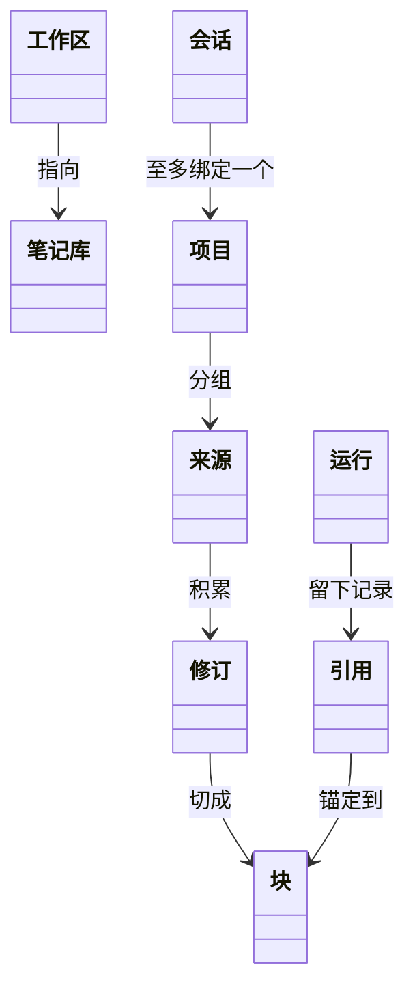
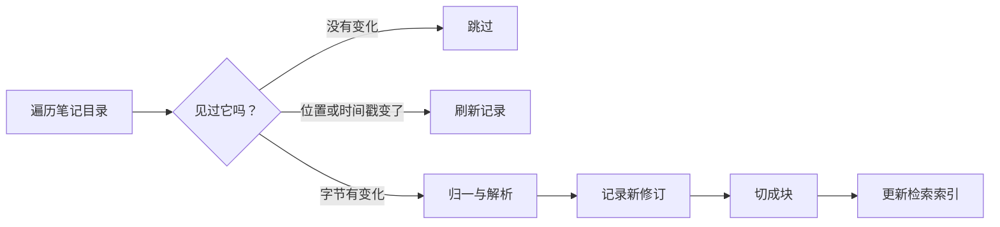

# 领域模型 {/* #domain-model */}

本站每个页面都只用同一小撮名词，而每个名词只有一个含义。这一页画出全图；[术语表](../glossary.md)用一句话定义每一条。

## 模型的形状 {/* #map */}

全图一张——每根箭头都是术语表定义过的关系：

工作区指向恰好一个笔记库；来源不断积累不可变修订；修订被切成块；项目把来源分组；会话至多绑定一个项目；引用把答案锚定到它所立足的块。

## 地基：工作区罩着笔记库 {/* #ground */}

你在一个[工作区](../glossary.md#workspace)里做事——一个目录、一个数据库——并把它指向一个[笔记库](../glossary.md#vault)：那就是你本来就在用的那一棵 Markdown 笔记树。索引只覆盖这棵树，不多碰别处；数据库与论文原文就放在它旁边。

## 从笔记到库材料 {/* #indexing */}

索引是文件变成可引用材料的通路——而且它只做追加：

没有变化的文件被跳过；只是移动过、或时间戳动过的，刷新它记录下来的位置；字节变了的成为新修订，接着是块，再接着是索引条目。新笔记的第一遍只是同一条路、前面什么都不存在。库里没有任何东西被覆盖——更新只做追加。

## 来源是身份，不是路径 {/* #sources */}

库里能引用的东西都是[来源](../glossary.md#source)：一篇笔记、一篇论文，以后还有网页文档。来源的身份是它的[来源键](../glossary.md#source-key)（`note:…`、`arxiv:…`），而不是它在磁盘上碰巧所处的位置——改个文件名就是一个新来源，旧的键永远不改写。来源每变一次，就多出一个新的[来源修订](../glossary.md#source-revision)：一份不可变的字节快照。更新是追加，什么都不覆盖。

## 检索以块为单位 {/* #chunks */}

一个修订会被切成[块](../glossary.md#chunk)——检索命中、引文定位所依据的确定性投影。每个块都带着一个[来源类别](../glossary.md#origin-class)：字节是谁写的——你的笔记、论文、网页、agent 产出，还是系统自己。一份索引同时覆盖笔记与论文，一次查询返回按来源加权排序的混合结果，让两类材料互相校验——完整叙述见[检索与引用](retrieval-and-citations.md)。

## 书桌：项目、会话、批注、启发卡 {/* #desk */}

库的上面是你的书桌。[项目](../glossary.md#project)是给一组来源起的名字——一个抽屉，不是第二座库。[会话](../glossary.md#session)是一条至多绑定一个项目的对话线索。[批注](../glossary.md#annotation)把你的手写笔记钉在某个修订的确切位置上。[启发卡](../glossary.md#spark)是 agent 提议的带引用卡片；收下或丢弃，是它仅有的两种去向。

## 劳动与答案：运行 {/* #runs */}

每一件被受理的劳动都是一次[运行](../glossary.md#run)——有记录、可审计、有终态。[提问运行](../glossary.md#ask)是先在代码里检索与构建上下文、然后至多发起一次模型调用的那种运行；什么内容进入上下文由[上下文范围](../glossary.md#context-scope)决定。答案携带[引用](../glossary.md#citation)——把论断绑定到字节的五元组——每条引用都要与记录下来的修订做[校验](../glossary.md#verification)。整份复原记录就是一段可回放的[回放](../glossary.md#trace)。

## 去哪里继续 {/* #next */}

- [定位与原则](positioning.md)——模型背后的姿态。
- [检索与引用](retrieval-and-citations.md)——这些零件在同一次查询里怎么协同。
- [设计决策](decisions.md)——每个形状为何如此。
- [术语表](../glossary.md)——一词一句话。
