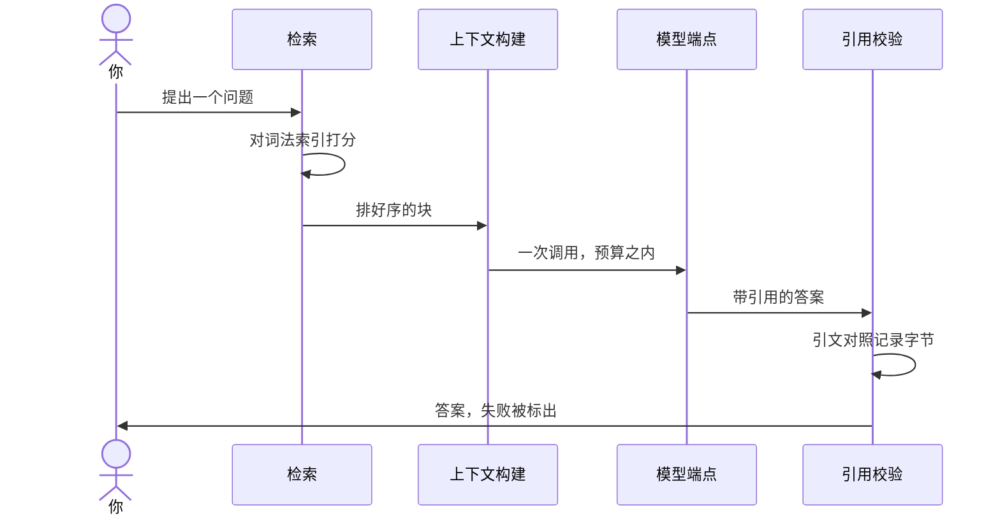

# 检索与引用 {/* #retrieval-and-citations */}

这是工作台正中央的那个循环：查询走进一份词法索引，最好的材料带着排序回来，答案里的每一条论断都能指回可以被检查的字节。

## 一次提问，从头到尾 {/* #one-ask */}

把正中央的循环展开成一条序列：

到那唯一一次模型调用为止，一切由代码完成；之后的检查也由代码完成——模型既不决定取什么，也不认证自己的答案。

## 一份索引，同时罩着笔记与论文 {/* #one-index */}

笔记与论文住进同一份词法索引，于是一次查询返回混合结果——论文的命中旁边就是谈论它的那篇笔记，笔记的命中也能带出它的论文。结果按来源加权排序：你自己写的东西分量高于论文，论文高于网页副本。同库检索正是设计的目的——两类材料互为对照——而不是把两次搜索缝在一起。

## 确定性优先 {/* #deterministic */}

搜索不花模型一分力：打分是词法的，中日文文本原生分词。这就是搜索快、能离线、且可解释的原因——也是它每台机器、每次运行都一样的原因。

## 从命中到块 {/* #hits-to-chunks */}

检索的单位是[块](../glossary.md#chunk)。每个命中都是某个[来源修订](../glossary.md#source-revision)里的一块——正因如此，[引用](../glossary.md#citation)才可能存在。命中不是答案；它是带着位置的证据。

## 引用五元组 {/* #citation-tuple */}

答案里的每条论断都能沿着五元组回查：来源键、修订、修订内的定位、引文原文、引文的哈希。它们合起来把论断钉到字节上——不是钉到某份"大概存在"的文档，而是钉到这次运行发生时确实存在的确切文字。

## 校验是一等状态 {/* #verification */}

答案展示之前，它的每条引用都要与记录下来的修订核对：引文必须一字不差地在那里。校验失败的引用会被醒目地报为失败——绝不悄悄丢弃——因为模型的记忆不是证据，记录下来的字节才是。校验失败是设计好的结局，不是错误状态。

## 什么能到达模型 {/* #context */}

检索决定什么值得展示；[上下文范围](../glossary.md#context-scope)决定什么可以进入模型的上下文：P1 是已绑定项目的材料（没绑定时是整个笔记库），P2 是其余部分。这个划分只影响模型看到什么——永远不影响检索记录了什么。

## 回放 {/* #replay */}

查询、证据、提示、模型的回答与校验结论被一起记录成一段[回放](../glossary.md#trace)。回放不了的[运行](../glossary.md#run)，是信不过的运行。

## 去哪里继续 {/* #next */}

- [领域模型](domain-model.md)——上面用到的那些名词。
- [设计决策](decisions.md)——为什么词法优先、为什么校验是状态而不是脚注。
