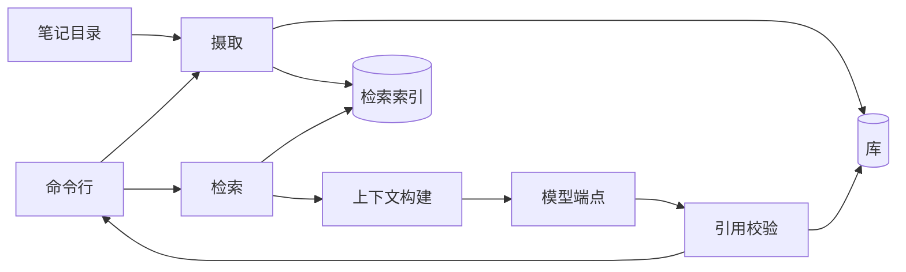
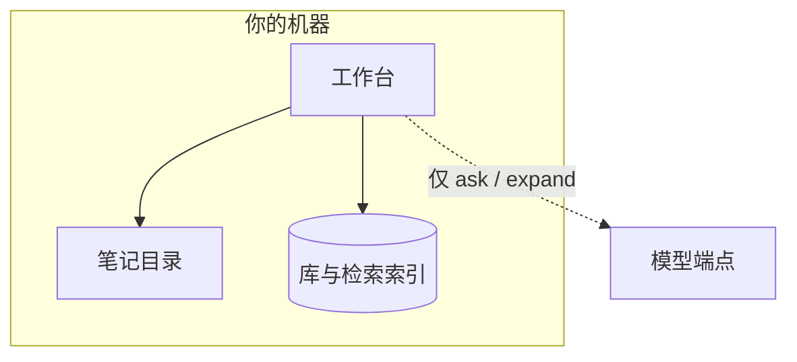

# 架构一览 {/* #system-overview */}

这一页是地图：工作台由哪几部分组成、它们跑在哪里、要改某件事时该看哪一部分。

## 组成部分与一条工作的通路 {/* #parts */}

工作从**摄取**进入：笔记被遍历、归一，作为不可变修订记录进库，再投影进检索索引。问题走相反的方向：**检索**读取索引，**上下文构建**决定什么可以进入那一次模型调用，**引用校验**在你看到之前把回答与记录下来的字节核对。

## 各个部分，各一句话 {/* #list */}

- **摄取**接住笔记里的变化：归一、记录结果——修订、块，以及围绕它们的审计事件。
- **库**是装着工作台事实的数据库：修订、运行、引用，以及整张书桌。
- **检索索引**是可重建的派生索引，把查询与块对上；丢了它只花时间，不丢数据。
- **检索**对索引打分，返回带位置的排序证据。
- **上下文构建**在固定预算内决定什么可以进入模型的上下文。
- **模型调用**只与你配置的那一个 provider 端点对话——唯一的网络通路，只用于 `ask` 与展开检索，别处不用。
- **引用校验**把每条论断的引文与记录下来的字节核对；失败保持可见。
- **命令行**是今天的面：接收命令、展示结果。以后的面调用同一批部件。

## 一切跑在哪里 {/* #where */}

除那一条虚线外，一切都在你自己的机器上跑。索引、检索、回放与引用校验完全不需要网络；唯一的出站连接是你配置的模型端点。工作区就是一个目录：复制它就是复制整张书桌——你的库不会被收集、也不会被发往任何地方。

## 要改某件事时看哪里 {/* #changes */}

| 当要改的是…… | 该看的部分 |
|---|---|
| 笔记怎么被接住、归一、切成块 | 摄取 |
| 什么算记录下来的事实——修订、运行、引用、书桌 | 库 |
| 查询怎么打分、加权、分词 | 检索索引与检索 |
| 什么可以进入模型上下文、预算是多少 | 上下文构建 |
| 与 provider 的对话 | 模型调用 |
| "通过校验"对一条引用意味着什么 | 引用校验 |
| 面展示什么、打印什么 | 命令行 |

这张地图有意停在组件名这一层：内部会变，组件不变。

## 去哪里继续 {/* #next */}

- [领域模型](domain-model.md)——那些名词，各一句话。
- [检索与引用](retrieval-and-citations.md)——正中央的循环，逐步展开。
- [设计决策](decisions.md)——为什么形状长成这样。
