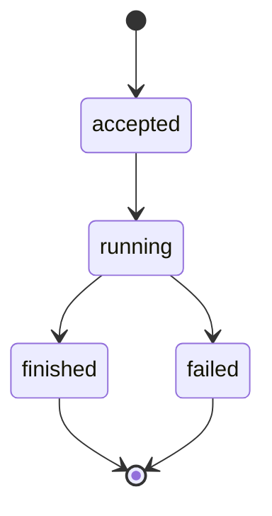

# 回放一次运行 {/* #trace-a-run */}

每一次[运行](../glossary.md#run)都有记录，因此事后都能回答。`ask` 的答案会打印 id，把它交给 `trace`：

```bash
momotaro trace <run_id>
```

回放按顺序回答四个问题：

1. **检索找到了什么？** 当时的查询原文，以及带位置信息的排序命中。
2. **模型看到了什么？** 实际送出的上下文片段——它面前没有别的东西。
3. **用了哪些引用？** 每条论断的五元组：来源键、修订、定位、引文、哈希。
4. **通过校验了吗？** 每条引用与记录下来的字节核对后的结论。

脚本要读其中任何一项时，加 `--json`。

## 一次运行的生命周期 {/* #life */}

每次运行都走同一条路，终点与它一起被记录下来：



状态名就是记录下来的取值本身——任何语言里都保持原拼写，`trace` 也按原样回放。

## 为什么值得做 {/* #why */}

回放不了的一次运行，是信不过的一次运行——记录运行的全部意义就在这里。当一个答案感觉不对劲时，回放把"模型说了奇怪的话"变成具体的问题：是检索漏了、上下文缺了合适的片段、还是某条论断没过检查。每一种都有不同的修法。

同一条命令也适用于 `search --mode expand` 背后的运行——它那次改写查询的调用同样被记录下来。

## 去哪里继续 {/* #next */}

- [引用循环](../concepts/retrieval-and-citations.md)——四个答案合在一起意味着什么。
- [带引用的提问](ask-with-citations.md)——运行 id 从哪里来。
